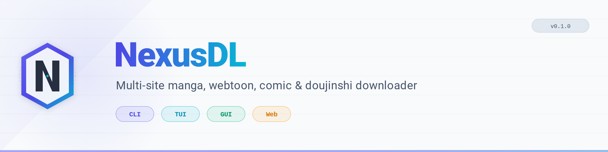

## 📄 `README.md` — complet


<div align="center">



# NexusDL

**Multi-site manga, webtoon, comic and doujinshi downloader.**

CLI · TUI · GUI · Web · API

[](https://github.com/Voldigoad-Holdings/nexus-dl/actions/workflows/test.yml)
[](https://github.com/Voldigoad-Holdings/nexus-dl/actions/workflows/lint.yml)
[](https://github.com/Voldigoad-Holdings/nexus-dl/actions/workflows/docker.yml)
[](https://pypi.org/project/nexusdl/)
[](https://www.python.org/)
[](LICENSE)
[](https://github.com/astral-sh/ruff)
[](https://mypy-lang.org/)
[](CODE_OF_CONDUCT.md)

[Features](#-features) · [Quick start](#-quick-start) · [Installation](#-installation) · [Usage](#-usage) · [Configuration](#%EF%B8%8F-configuration) · [Architecture](#%EF%B8%8F-architecture) · [Contributing](#-contributing) · [License](#-license)

</div>

---

## 📖 What is NexusDL?

NexusDL is a modern, modular, and extensible downloader for **manga**, **webtoons**, **comics**, and **doujinshi** from 60+ sites. It is a from-scratch rewrite of the legacy "SushiDL" project, designed around **hexagonal architecture**, **strict typing**, and **async-first** I/O.

It ships with **four interfaces**:

| Interface | Command | Use case |
|---|---|---|
| 🖥️ **CLI** | `nexusdl` | Scriptable, ideal for cron jobs and CI |
| 🎛️ **TUI** | `nexusdl-tui` | Interactive terminal UI for power users |
| 🪟 **GUI** | `nexusdl-gui` | Desktop app for casual users |
| 🌐 **Web** | `nexusdl-web` | Self-hosted web app + REST/WebSocket API |

---

## ✨ Features

### Content
- 🗂️ **60+ sites** across 4 languages (FR, EN, KR, and adult)
- 🎯 **Multi-site search** in parallel with unified results
- 📚 **Local library** with **FTS5** full-text search
- 📖 **Reading progress** tracking
- 🔄 **Incremental updates** — only downloads new chapters

### Formats
- 📁 **FOLDER** — raw image files
- 🗜️ **ZIP** — standard archive
- 📦 **CBZ** — with `ComicInfo.xml` metadata
- 📦 **CB7** — 7z variant with metadata
- 📄 **PDF** — one page per image
- 🗃️ **CBT** — tar archive (optional)

> **CBR is not supported** — RAR is proprietary and legally incompatible with GPL-3.0. See [ADR-002](docs/source/development/decisions/002-no-cbr.md).

### Anti-bot & anti-ban
- 🛡️ **Cloudflare bypass** via Playwright and FlareSolverr
- 🔁 **Proxy rotation** with health checks
- ⏱️ **Token-bucket rate limiting** per site
- 🧯 **Circuit breakers** to isolate failing sites
- 💾 **HTTP caching** via `hishel`
- 🎭 **User-agent rotation**

### Developer experience
- 🏗️ **Hexagonal architecture** — `core/` never imports `parsers/`
- 🎯 **Strict typing** — `mypy --strict` passes
- 📝 **Google-style docstrings** everywhere
- 🧪 **pytest** + **respx** + **hypothesis**
- 🎨 **ruff** for lint + format
- 🚦 **pre-commit** hooks
- 🐳 **Docker** multi-stage builds
- ⚙️ **GitHub Actions** matrix: Linux + macOS + Windows

### Privacy & security
- 🔐 **All secrets via `.env`** — never hardcoded
- 🔒 **Encrypted cookies** at rest (`cryptography.Fernet`)
- 🎫 **JWT authentication** for the API
- 🤖 **robots.txt enforcement** (opt-out available)
- 🧱 **Content filtering** opt-in (`NEXUSDL_ALLOW_ADULT=false` by default)
- 🧨 **`check_imports.py`** fails CI on hardcoded tokens or private keys

---

## ⚡ Quick start

### Prerequisites

- **Python 3.12+**
- **Git**
- **uv** (recommended) or `pip`
- **Node.js 20+** and **pnpm 9+** (only for the web UI)
- **Docker** (optional)
- **Playwright** (optional, for JS-heavy sites)

### Install with `uv` (recommended)

```bash
# Install uv (once)
curl -LsSf https://astral.sh/uv/install.sh | sh

# Clone and install
git clone https://github.com/Voldigoad-Holdings/nexus-dl.git
cd nexus-dl

uv python install 3.12
uv venv
source .venv/bin/activate      # Linux/macOS
# .venv\Scripts\activate       # Windows

uv pip install -e ".[all]"
```

### Install with `pip` (classic)

```bash
git clone https://github.com/Voldigoad-Holdings/nexus-dl.git
cd nexus-dl

python3.12 -m venv .venv
source .venv/bin/activate

pip install --upgrade pip
pip install -e ".[all]"
```

### Install from PyPI (once published)

```bash
pip install nexusdl[all]
```

### Configure

```bash
cp .env.example .env
chmod 600 .env
```

Edit `.env` and set **at least** these three secrets:

```dotenv
NEXUSDL_SECRET_KEY=<generate-with-python>
NEXUSDL_JWT_SECRET=<generate-with-python>
NEXUSDL_COOKIE_ENCRYPTION_KEY=<generate-with-python>
```

Generate secure values:

```bash
python -c "import secrets; print(secrets.token_hex(32))"
```

Run the command **three times** to get three distinct keys.

### First download

```bash
# Search
nexusdl search "one piece" --sites mangadex,mangafire

# Download
nexusdl download "https://mangadex.org/title/<uuid>" --format cbz --dest ~/Manga

# Launch TUI
nexusdl-tui

# Launch GUI
nexusdl-gui

# Launch web
nexusdl-web
```

---

## 📦 Installation

### Linux

```bash
# Debian / Ubuntu
sudo apt install -y python3.12 python3.12-venv python3.12-dev git

# Fedora
sudo dnf install -y python3.12 python3.12-devel git

# Arch
sudo pacman -S python git

# Then follow the uv or pip instructions above
```

### macOS

```bash
# Homebrew
brew install python@3.12 git

# Then follow the uv or pip instructions above
```

### Windows

```powershell
# Winget
winget install Python.Python.3.12
winget install Git.Git

# Or Chocolatey
choco install python312 git

# Then follow the uv or pip instructions above
```

### Docker

```bash
# Clone
git clone https://github.com/Voldigoad-Holdings/nexus-dl.git
cd nexus-dl

# Configure
cp .env.example .env
# Edit .env with your secrets

# Start the full stack
docker compose -f docker/docker-compose.yml up -d
```

Access the web UI at `http://localhost:3000` and the API at `http://localhost:8000`.

---

## 🚀 Usage

### CLI

```bash
# List supported sites
nexusdl sites

# Search across all sites
nexusdl search "attack on titan" --all

# Search one specific site
nexusdl search "one piece" --site mangadex

# Download by URL
nexusdl download "https://mangadex.org/title/<uuid>" --format cbz

# Download specific chapters
nexusdl download "<url>" --chapters 1,2,3 --format pdf

# Update an existing library
nexusdl update --library ~/Manga

# Show configuration
nexusdl config
```

### TUI

```bash
nexusdl-tui
```

Keyboard shortcuts:

| Key | Action |
|---|---|
| `s` | Search |
| `d` | Downloads |
| `l` | Library |
| `c` | Settings |
| `q` | Quit |
| `?` | Help |

### GUI

```bash
nexusdl-gui
```

### Web

```bash
nexusdl-web
# → http://localhost:8000 (API)
# → http://localhost:3000 (frontend, if built)
```

### Python API

```python
import asyncio
from pathlib import Path
from nexusdl.core.config import load_settings
from nexusdl.core.registry.site_registry import SiteRegistry
from nexusdl.core.downloader.manager import DownloadManager
from nexusdl.parsers.factory import ParserFactory


async def main() -> None:
    settings = load_settings()
    registry = SiteRegistry(settings, parser_factory=ParserFactory())
    manager = DownloadManager(registry, settings)

    results = [r async for r in registry.search_all("one piece")]
    print(f"{len(results)} results")

    async for result in manager.download_manga(
        results[0].manga,
        dest=Path("~/Manga").expanduser(),
        fmt="CBZ",
    ):
        print(f"✓ {result.output_path}")


asyncio.run(main())
```

---

## ⚙️ Configuration

NexusDL uses **`pydantic-settings`** — all configuration is read from `.env` and environment variables prefixed with `NEXUSDL_`.

### Minimal `.env`

```dotenv
NEXUSDL_SECRET_KEY=<64-hex-chars>
NEXUSDL_JWT_SECRET=<64-hex-chars>
NEXUSDL_COOKIE_ENCRYPTION_KEY=<64-hex-chars>
```

### Common overrides

```dotenv
# Enable adult content (18+)
NEXUSDL_ALLOW_ADULT=true

# Enable Playwright (JS-heavy sites)
NEXUSDL_PLAYWRIGHT_ENABLED=true

# Use FlareSolverr (alternative to Playwright)
NEXUSDL_FLARESOLVERR_URL=http://localhost:8191/v1

# Disable robots.txt enforcement (NOT recommended)
NEXUSDL_RESPECT_ROBOTS_TXT=false

# Custom download directory
NEXUSDL_DOWNLOAD_DIR=~/Manga

# Log format
NEXUSDL_LOG_FORMAT=json
```

### Where config lives

| Platform | Path |
|---|---|
| Linux | `~/.config/nexusdl/` (config), `~/.local/share/nexusdl/` (data), `~/.local/state/nexusdl/logs/` (logs) |
| macOS | `~/Library/Application Support/nexusdl/`, `~/Library/Logs/nexusdl/` |
| Windows | `%APPDATA%\nexusdl\`, `%LOCALAPPDATA%\nexusdl\` |

### Site configuration

Site URLs, selectors, and capabilities live in **`src/nexusdl/data/sites.yaml`** — **not** in `.env`. This keeps the deployment config (secrets, URLs) separate from the content config (scraped sites).

See [`docs/source/usage/configuration.md`](docs/source/usage/configuration.md) for the full reference.

---

## 🏗️ Architecture

NexusDL follows a **hexagonal architecture** — the domain is at the center, and all I/O goes through ports (Protocols) and adapters (parsers, interfaces).

```
┌─────────────────────────────────────────────────────┐
│           INTERFACES (primary adapters)             │
│   CLI · TUI · GUI · Web API · Web UI                │
└────────────────────────┬────────────────────────────┘
                         ▼
┌─────────────────────────────────────────────────────┐
│                    CORE (domain)                    │
│  models · downloader · packaging · library ·        │
│  session · registry · events · config               │
└────────────────────────┬────────────────────────────┘
                         ▼
┌─────────────────────────────────────────────────────┐
│         PARSERS (secondary adapters)                │
│   fr/ · en/ · kr/ · adult/ · custom/ · mixins/      │
└─────────────────────────────────────────────────────┘
```

### Dependency rules (enforced in CI)

1. `core/` **never** imports `parsers/`, `interfaces/`, or `plugins/`
2. `parsers/` **never** imports `interfaces/` or `plugins/`
3. `plugins/` **never** imports `interfaces/` or `parsers/`
4. `interfaces/` may import everything
5. Cross-layer communication goes through **Protocols** defined in `core/`
   (`ParserFactory` in `core/registry/protocols.py`)

Run the checker locally:

```bash
python scripts/check_imports.py
```

See [`docs/source/development/architecture.md`](docs/source/development/architecture.md) for details, and [`docs/source/development/decisions/`](docs/source/development/decisions/) for the ADRs.

---

## 🧪 Development

```bash
# Install dev dependencies
make install-dev

# Run lint
make lint

# Run tests
make test

# Run full check (lint + tests + build)
make check-full

# Build sdist + wheel
make build

# Clean everything
make clean
```

See [`CONTRIBUTING.md`](CONTRIBUTING.md) for the full guide.

---

## 🔒 Security

- **Never** commit secrets (`.env`, `*.key`, `*.pem`)
- **Never** post tokens or cookies in issues, PRs, or chat
- **Report vulnerabilities privately** — see [`SECURITY.md`](SECURITY.md)

Our CI blocks any commit containing:
- GitHub tokens (`ghp_`, `gho_`, `ghs_`, `ghr_`)
- AWS keys (`AKIA…`)
- Private key blocks (`-----BEGIN … PRIVATE KEY-----`)
- Hardcoded site URLs in Python code

---

## 🤝 Contributing

We welcome contributions of all kinds:

- 🐛 Bug reports
- 📝 Documentation improvements
- 🌍 Translations
- 🎨 Design (icons, banners, mockups)
- 🧪 Tests
- 🌐 New site parsers
- 🔌 Plugins
- 🏗️ Architecture improvements

See [`CONTRIBUTING.md`](CONTRIBUTING.md) for the full guide, and
[`CODE_OF_CONDUCT.md`](CODE_OF_CONDUCT.md) for our community standards.

### Good first issues

Looking for a place to start? Check out issues labeled
[`good first issue`](https://github.com/Voldigoad-Holdings/nexus-dl/labels/good%20first%20issue)
or [`help wanted`](https://github.com/Voldigoad-Holdings/nexus-dl/labels/help%20wanted).

---

## 📜 License

NexusDL is licensed under the **GNU General Public License v3.0 or later**
(GPL-3.0-or-later).

```
NexusDL
Copyright (C) 2026 Voldigoad-Holdings

This program is free software: you can redistribute it and/or modify
it under the terms of the GNU General Public License as published by
the Free Software Foundation, either version 3 of the License, or
(at your option) any later version.

This program is distributed in the hope that it will be useful,
but WITHOUT ANY WARRANTY; without even the implied warranty of
MERCHANTABILITY or FITNESS FOR A PARTICULAR PURPOSE.  See the
GNU General Public License for more details.

You should have received a copy of the GNU General Public License
along with this program.  If not, see <https://www.gnu.org/licenses/>.
```

See [`LICENSE`](LICENSE) for the full text.

### Why GPL-3.0?

GPL-3.0 ensures that NexusDL — and any derivative work — stays free and
open-source. It also protects users' freedom to modify and redistribute the
software. We believe in the four freedoms of free software, and we want
NexusDL to remain a community-driven project.

If you need a different license for a specific use case, please
[open a discussion](https://github.com/Voldigoad-Holdings/nexus-dl/discussions).

---

## ⚠️ Legal notice

NexusDL is a **technical tool**. It does **not** host, distribute, or endorse
any content. It downloads content from third-party websites at the request of
the user.

- Users are **solely responsible** for the content they download and for
  complying with the laws of their jurisdiction.
- NexusDL respects `robots.txt` and site Terms of Service **by default**
  (`NEXUSDL_RESPECT_ROBOTS_TXT=true`).
- Adult content support (`NEXUSDL_ALLOW_ADULT=true`) is an **opt-in** feature
  for adult users. It is disabled by default.
- NexusDL is intended for **personal, non-commercial use**. Do **not** use it
  to redistribute copyrighted works.
- If you are a rights-holder and believe NexusDL is being misused, please
  contact us through the channels in [`SECURITY.md`](SECURITY.md).

**Use at your own risk.** The authors and contributors of NexusDL disclaim any
liability for misuse.

---

## 🙏 Acknowledgments

NexusDL stands on the shoulders of giants. We are grateful to:

- [**Tachiyomi / Mihon**](https://github.com/mihonapp/mihon) — for pioneering the manga reader extension ecosystem
- [**Suwayomi**](https://github.com/Suwayomi/Suwayomi-Server) — for proving self-hosted manga servers are possible
- [**Hakuneko**](https://github.com/mangalh/hakuneko) — for its parser inspiration
- [**MangaDex**](https://mangadex.org/) — for its open API and community standards
- [**Contributor Covenant**](https://www.contributor-covenant.org/) — for the Code of Conduct
- [**Keep a Changelog**](https://keepachangelog.com/) and [**Conventional Commits**](https://www.conventionalcommits.org/) — for structured history
- The **Python**, **FastAPI**, **Pydantic**, **httpx**, **Playwright**, **Next.js**, and **TailwindCSS** communities

And to every contributor who has reported a bug, fixed a typo, translated a
string, or written a parser — **thank you**. 🙏

---

<div align="center">

**[⬆ Back to top](#nexusdl)**

Made by [Voldigoad-Holdings](https://github.com/Voldigoad-Holdings) and contributors.

</div>
````
